# Fitness

A React fitness website with exercises, meal tracking, profile that calculate your daily calories, and a shop for fitness gear, apparel, and supplements.

## technology used
-React
-HTML
-CSS
-javaScript

## Setup Instructions

1. Clone the repositoy:

 git clone https://github.com/hanzo-23/Fitness.git

2. Navigate to the project folder:

cd fitness

3. install the dependencies:

npm install

4. start the dev server:

npm start

## Live website

The project deploys to `https://hanzo-23.github.io/Fitness`:

## UI img:

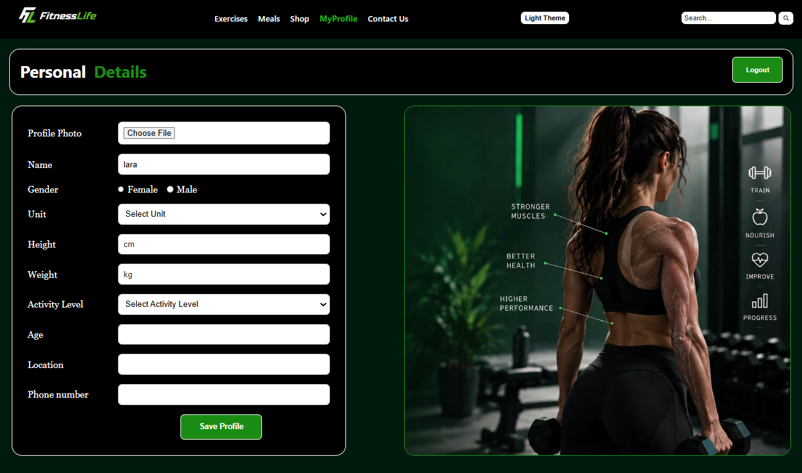

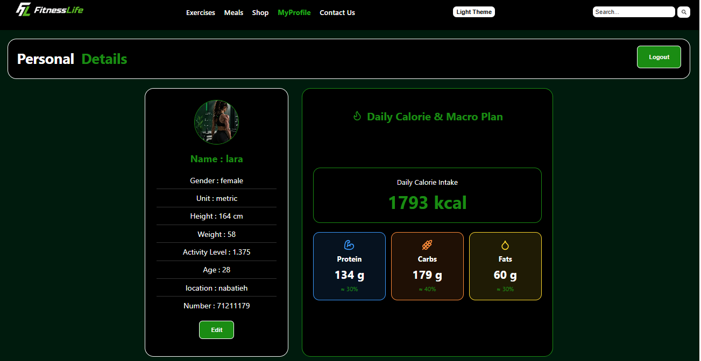

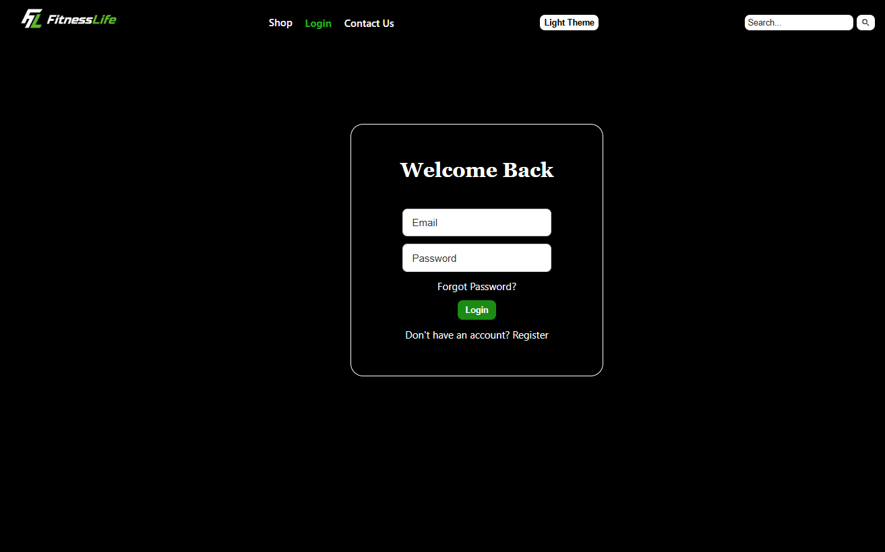

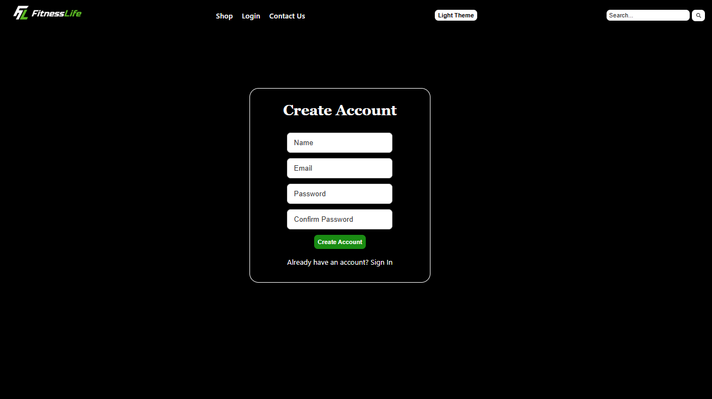

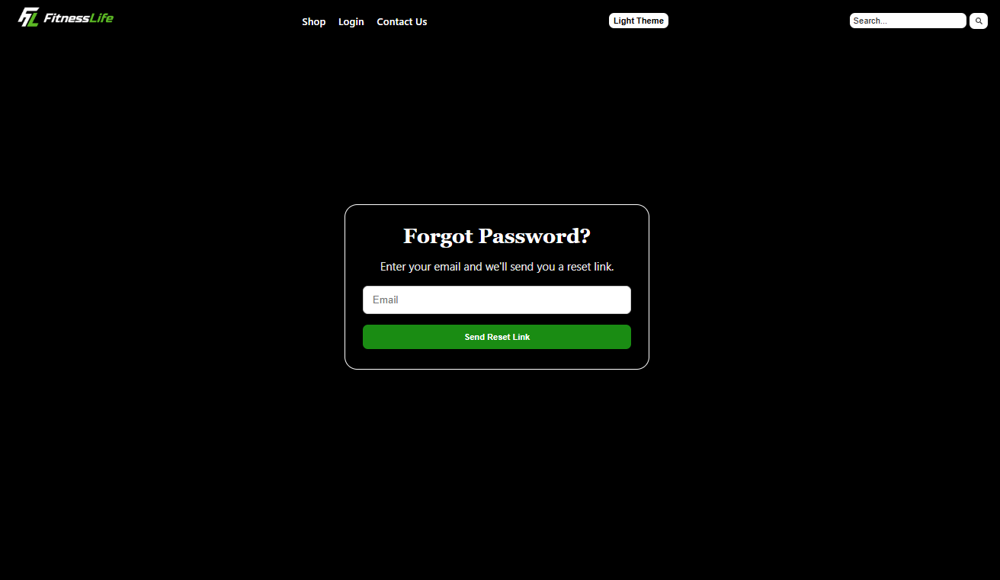

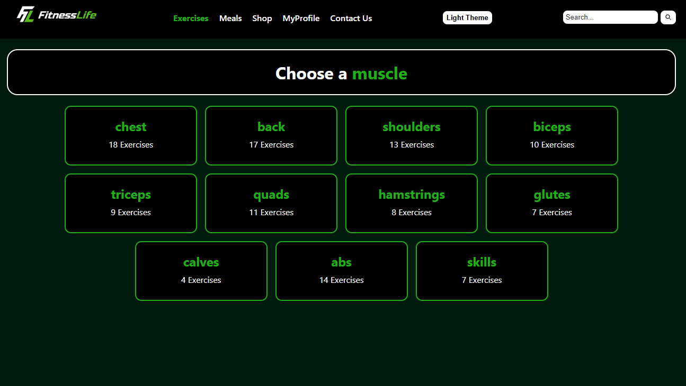

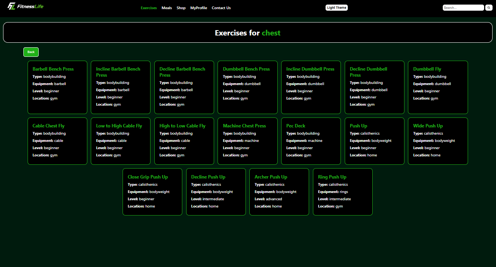

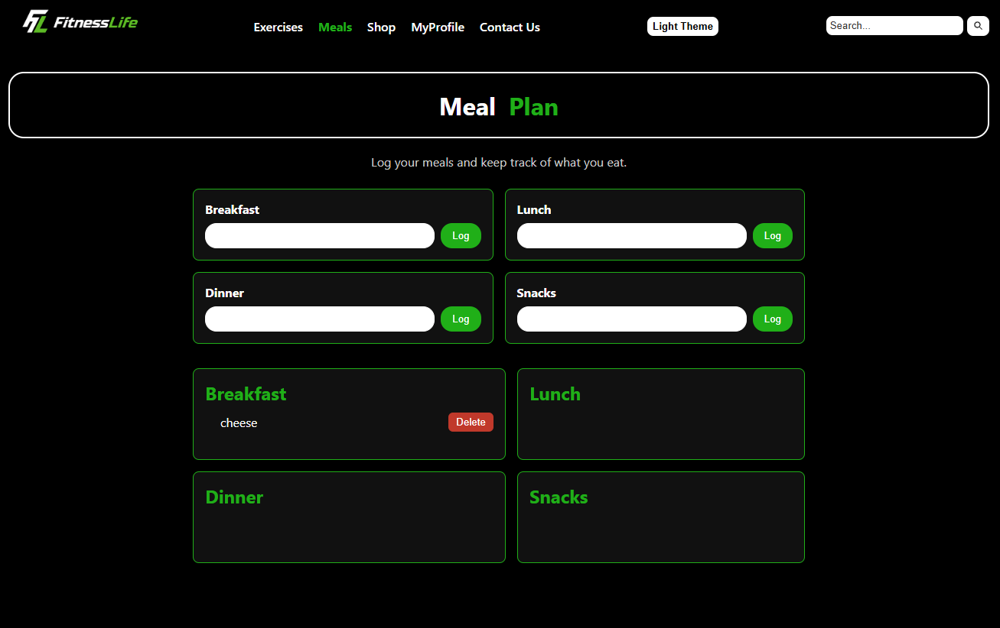

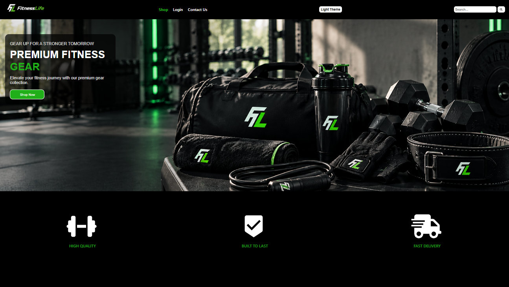

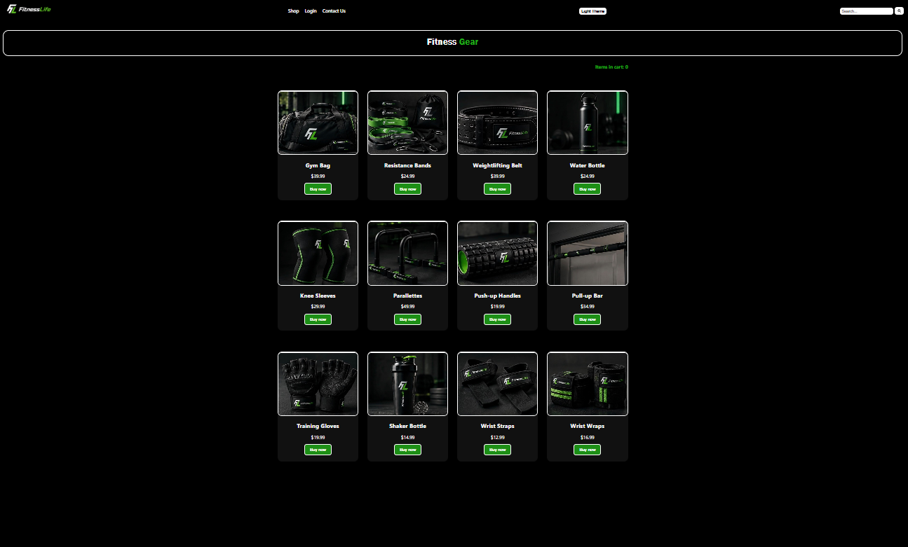

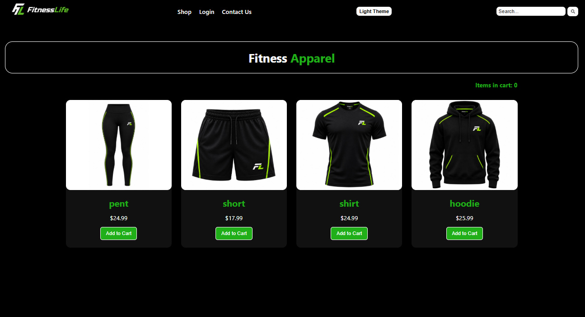

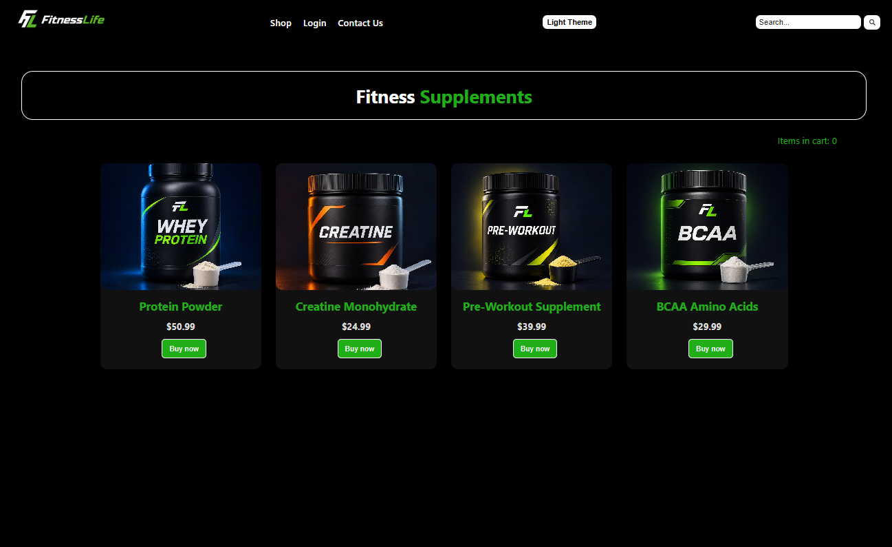

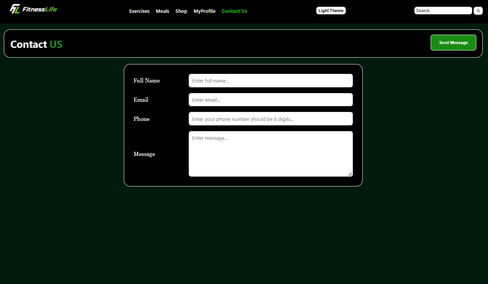