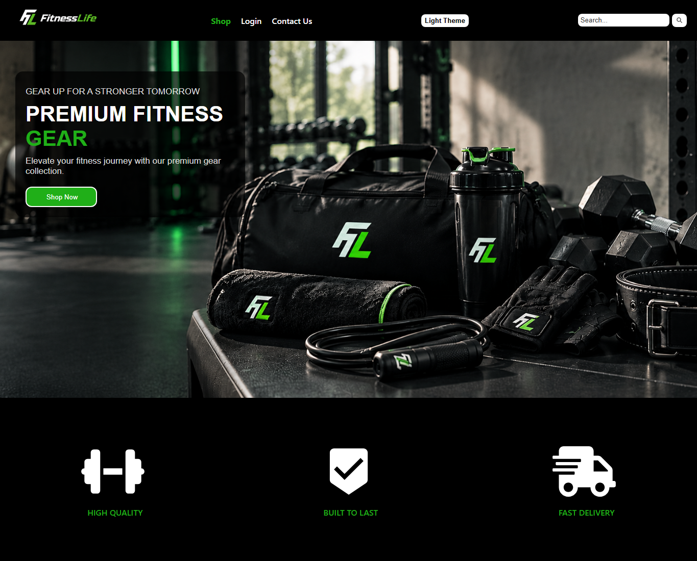

# FitnessLife

FitnessLife is a responsive fitness companion and shop built with React. It includes workout and meal-planning tools alongside a storefront for fitness gear, apparel, and supplements.

**Live site:** [hanzo-23.github.io/Fitness](https://hanzo-23.github.io/Fitness/)

## Features

- Browse exercise ideas by muscle group.
- Record and manage meal entries.
- Explore fitness gear, apparel, and supplements.
- Create a local demo profile and switch between light and dark themes.
- Use the responsive navigation on mobile and desktop.

Demo profile and meal data are stored in the browser; this project does not use a production account service or database.

## Screenshot



## Setup

Requirements: Node.js and npm.

```bash
git clone https://github.com/hanzo-23/Fitness.git
cd Fitness
npm install
npm start
```

The development server opens at [http://localhost:3000](http://localhost:3000).

Other useful commands:

```bash
npm test -- --watchAll=false
npm run build
```

## Deployment

The frontend is hosted on GitHub Pages. To publish an update, make sure your GitHub account can push to the repository, then run:

```bash
npm run deploy
```

This runs the production build and publishes the `build` folder to the `gh-pages` branch. In the repository's **Settings → Pages**, select the `gh-pages` branch and `/ (root)` as the source.

## Git history

The project is version-controlled with Git. To view its commit history:

```bash
git log --oneline --decorate
```
